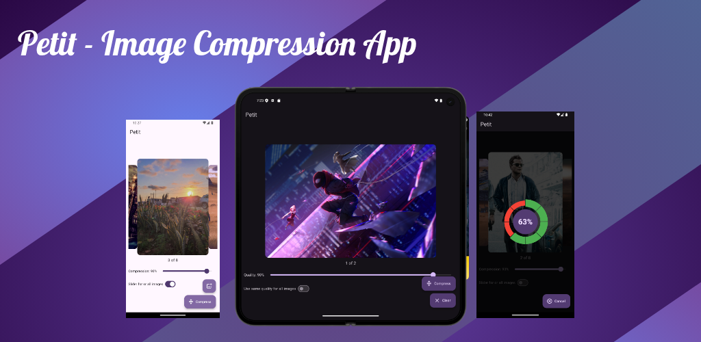
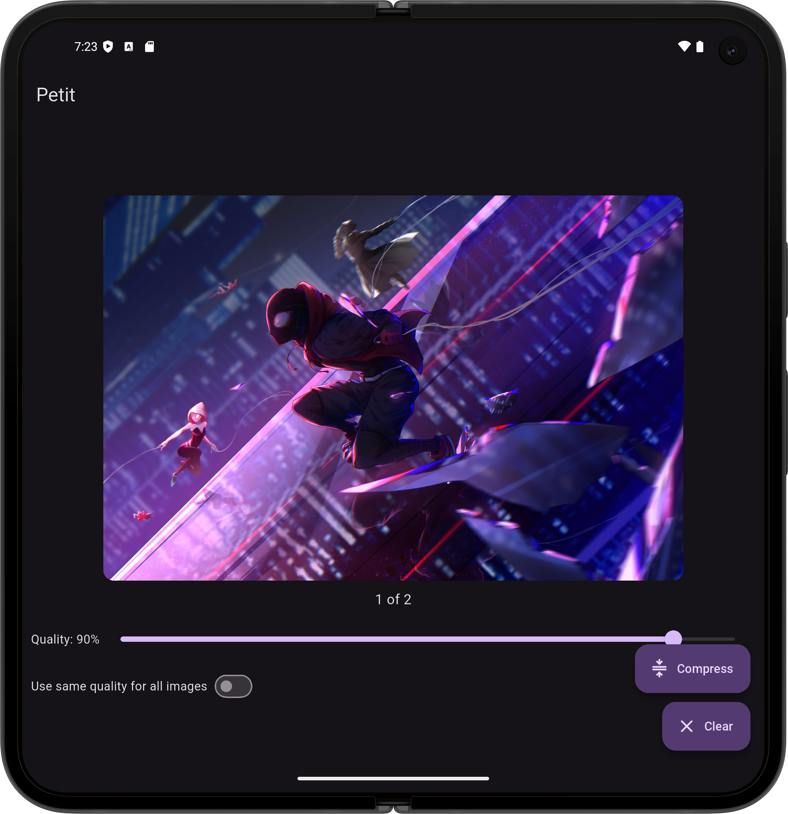
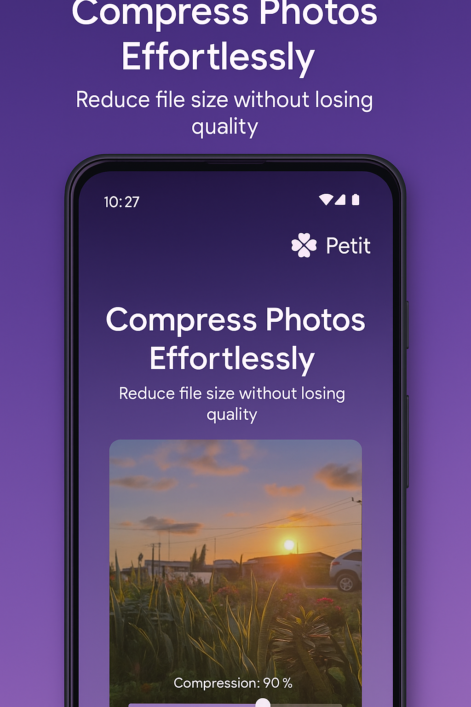
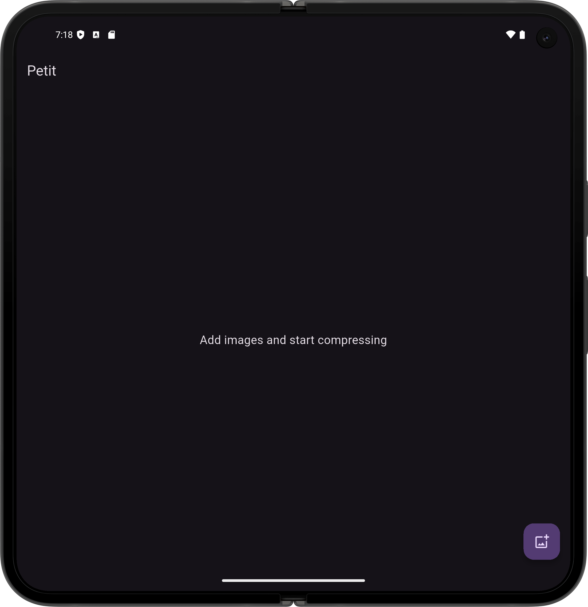
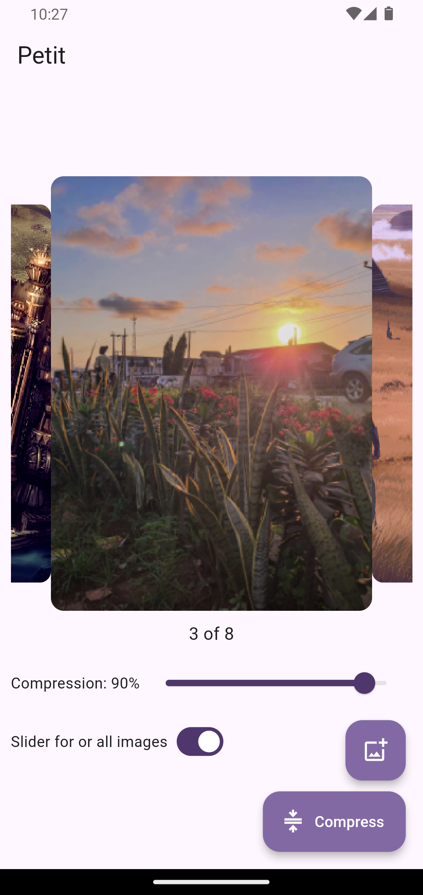
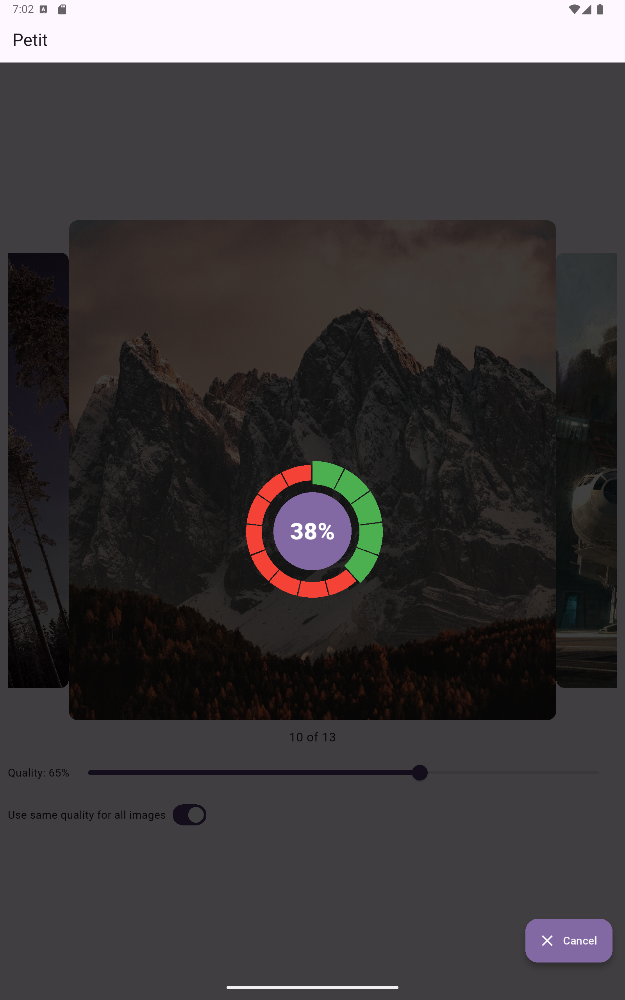

<p align="center">
  
</p>

<p align="center">
  <a href="https://appetize.io/app/b_fgilfsz7geymqqlykl7zv2ejsi?device=pixel7&osVersion=13.0&toolbar=true"
     target="_blank"
     rel="nofollow noopener noreferrer"
     aria-label="Live Demo - Appetize.io">
    <strong><u>Live Demo 🚀</u></strong>
  </a>
</p>

---

# 🧩 PETIT

**PETIT** is a **Flutter image and video compression application** that reduces file sizes for faster sharing and efficient storage—**without compromising quality**.

It works **completely offline** and supports multiple image and video formats.

---

## 📌 What PETIT Does (In Simple Terms)

PETIT makes your **images and videos smaller**, so they:

* Take up less space
* Send faster
* Maintain visual quality

### Supported Formats

**Images**

* JPG
* PNG
* HEIF
* HEIC

**Videos**

* H.264
* H.265 (HEVC)
* VP9

### How It Works

1. Select images or videos
2. Choose your preferred quality
3. Tap **Compress**
4. Compressed files are saved automatically to your device

---

## ⚠️ Note

* **WEBP compression is currently not very efficient**

---

## 📸 Screenshots

<p align="center">
  
  &nbsp;&nbsp;&nbsp;
  
</p>

<p align="center">
  
  &nbsp;&nbsp;&nbsp;
  
</p>

<p align="center">
  
</p>

---

## 📦 Packages Used

* **[Flutter Super]** – State management
* **[Image Picker]** – Select images locally or from cloud (Android)
* **[Flutter Image Compress]** – Compress PNG, JPG, and WEBP *(WEBP may be inefficient)*
* **[Heif Converter Plus]** – Convert HEIF / HEVC to JPEG
* **[Gallery Saver Plus]** – Save compressed files to device storage
* **[Image]** – Image decoding/encoding (resolution, resizing)
* **[Step Progress Indicator]** – Custom compression progress bar
* **[Carousel Slider]** – Scrollable image preview carousel

---

## 🔗 Package Links

* [Flutter Super]: https://pub.dev/documentation/flutter_super/latest/
* [Image Picker]: https://pub.dev/packages/image_picker
* [Flutter Image Compress]: https://pub.dev/packages/flutter_image_compress
* [Heif Converter Plus]: https://pub.dev/packages/heif_converter_plus
* [Gallery Saver Plus]: https://pub.dev/packages/gallery_saver_plus
* [Image]: https://pub.dev/packages/image
* [Step Progress Indicator]: https://pub.dev/documentation/step_progress_indicator/latest/
* [Carousel Slider]: https://pub.dev/packages/carousel_slider

---

## ▶️ First Run

After cloning the project, install dependencies:

```bash
flutter pub get
```

Then run code generation:

```bash
flutter pub run build_runner build
```

---

If you want, I can:

* Rewrite this as a **Google Play Store listing**
* Add a **Features** and **Architecture** section
* Turn this into a **case study** for your portfolio
